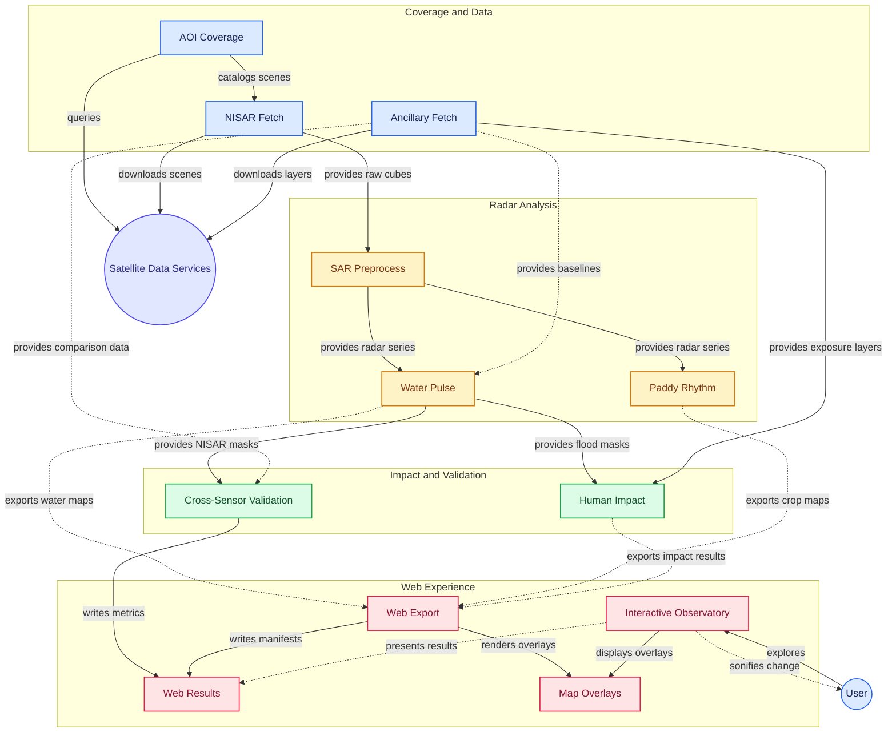
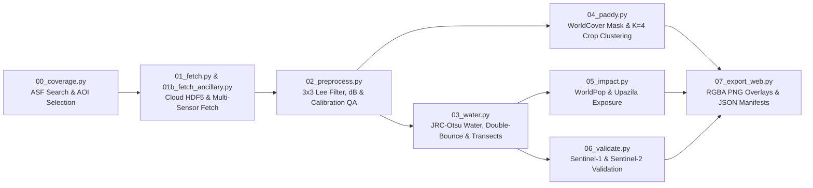
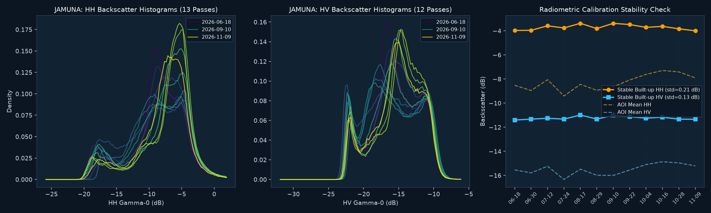
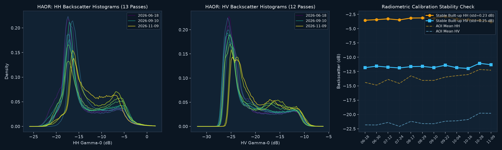
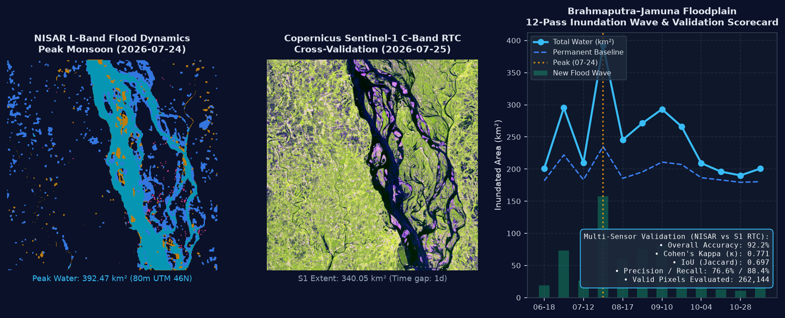
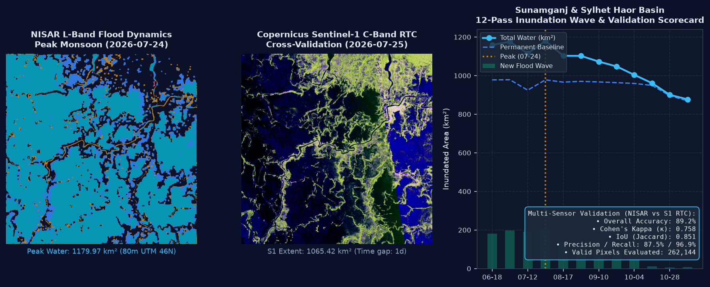
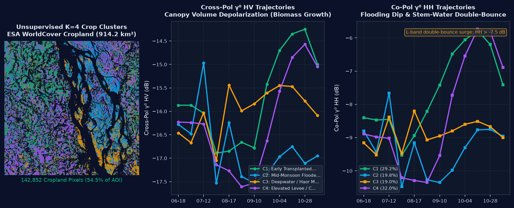
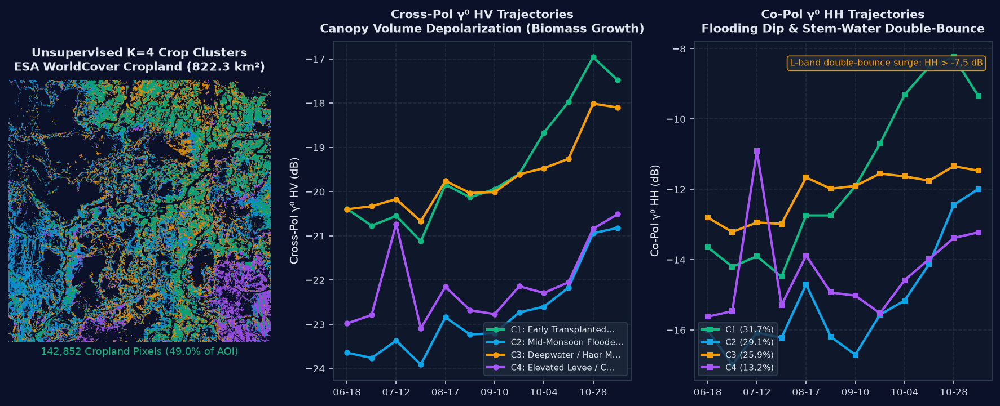

# Delta Pulse

**Tracking Monsoon Flood Dynamics, Braided River Migration, and Agricultural Phenology in Bangladesh with NASA–ISRO NISAR L-Band SAR**

*Built for the 2026 NASA Space Apps Challenge — Challenge: "Dancing with the SARs"*

---

## Overview

Every year between June and October, the Bengal Delta undergoes one of the most dramatic surface transformations on Earth. Snowmelt from the Himalayas and intense monsoon rainfall converge through the Brahmaputra–Jamuna and Meghna river systems, expanding river channels by several kilometers, submerging vast tectonic wetland basins (*haors*), reworking braided sandbars (*chars*), and driving the planting cycles of millions of smallholder rice fields. Yet throughout this entire five-month window, persistent monsoon cloud cover renders optical satellites largely blind.

**Delta Pulse** is an open-source geospatial web application and reproducible Python processing pipeline built on calibrated **NASA–ISRO Synthetic Aperture Radar (NISAR) Level-2 Geocoded Polarimetric Covariance (`GCOV`)** data (`NISAR_L2_GCOV_PROVISIONAL_V1`). Operating at a 24 cm L-band wavelength (`1.25 GHz`), NISAR pierces monsoon storm clouds day and night and penetrates emergent crop canopies that shorter-wavelength C-band radar cannot reach.

By combining a 12-pass calibrated NISAR time series (`June 18 – November 9, 2026`) with six real ancillary and validation datasets—EC JRC Global Surface Water, ESA WorldCover 10m, WorldPop 100m UN-adjusted population counts, geoBoundaries administrative polygons (`ADM2`/`ADM3`), Copernicus Sentinel-1 C-band RTC, and Copernicus Sentinel-2 L2A optical imagery—Delta Pulse translates complex dual-polarization radar observations (`HHHH` and `HVHV`) into interactive maps, quantitative impact estimates, cross-sensor validation metrics, and real-time audio sonification (**Change Radio**).

---

## Table of Contents

1. [Physical Motivation: Why L-Band SAR in the Monsoon?](#1-physical-motivation-why-l-band-sar-in-the-monsoon)
2. [Study Areas (AOIs)](#2-study-areas-aois)
3. [Datasets & Provenance](#3-datasets--provenance)
4. [Processing Pipeline & Scientific Methodology](#4-processing-pipeline--scientific-methodology)
5. [Quantitative Findings & Multi-Sensor Validation](#5-quantitative-findings--multi-sensor-validation)
6. [Web Application & "Change Radio" Sonification](#6-web-application--change-radio-sonification)
7. [Repository Structure](#7-repository-structure)
8. [Running the Application & Reproducing the Pipeline](#8-running-the-application--reproducing-the-pipeline)
9. [Known Limitations & Scientific Caveats](#9-known-limitations--scientific-caveats)
10. [Data Credits, Citations & License](#10-data-credits-citations--license)

---

## 1. Physical Motivation: Why L-Band SAR in the Monsoon?

Radar instruments measure two primary surface properties: **geometric roughness** at the scale of the radar wavelength and the **dielectric constant** (moisture content) of the target. In NISAR's dual-polarized L-band (`HH` co-polarization and `HV` cross-polarization) covariance grids, surface changes across the Bengal Delta separate into three distinct physical scattering regimes:

| Scattering Mechanism | Physical Process at 24 cm Wavelength (1.25 GHz) | NISAR Dual-Pol Signature ($\gamma^0$) | Environmental Feature Mapped |
| :--- | :--- | :--- | :--- |
| **Specular Forward Reflection** | Calm open water acts as a smooth mirror relative to a 24 cm wave, reflecting microwave pulses away from the side-looking antenna (`33°–47°` incidence angle). | Very low return in both channels: $\gamma^0_{HH} < -15.5\text{ dB}$, $\gamma^0_{HV} < -21.5\text{ dB}$. | Permanent river channels, deep haor lakes, and newly inundated open floodplains. |
| **Dihedral Corner Double-Bounce** | L-band waves penetrate upper foliage, reflect off the horizontal water surface onto vertical rice stalks, wetland reeds, or building walls, and bounce back toward the sensor. | Strong co-polarized surge ($\gamma^0_{HH} > -7.5\text{ dB}$) paired with a large polarization ratio ($\text{HH} - \text{HV} > 6.5\text{ dB}$). | Submerged rice paddies, flooded haor reed/swamp forests (*Hijal/Koroch*), and raised homestead mounds. |
| **Depolarized Volume Scattering** | Multiple scattering within randomly oriented leaves, stems, and branches depolarizes the horizontal transmit wave into a vertical receive echo. | Progressive rise in cross-polarized $\gamma^0_{HV}$ ($-19\text{ dB} \rightarrow -11\text{ dB}$) and narrowed $\text{HV}-\text{HH}$ gap. | Vegetative growth and biomass accumulation across transplanted *Aman* and *Boro* croplands. |

Unlike 5.6 cm C-band radar (Copernicus Sentinel-1), which scatters primarily off the top layer of leaves and is more sensitive to wind-induced capillary ripples on open water, NISAR's 24 cm L-band wave penetrates through crop canopies to detect standing water beneath vegetation and remains more stable across wind-roughened river fetches.

---

## 2. Study Areas (AOIs)

Both study areas are extracted from the exact same orbital geometry—**Track 069, Frame 014, Ascending (`T069_F014_A`)**—on an aligned `512 × 512` pixel grid at `80 m` posting (`40.96 km × 40.96 km` = `1,677.72 km²` per AOI) in **UTM Zone 46N (`EPSG:32646`)**:

1. **Brahmaputra–Jamuna Floodplain & Char Lands (`jamuna`)**
   - **Bounding Coordinates:** `89.46°E – 89.87°E`, `24.43°N – 24.81°N` (`UTM X: 141,720 – 182,600 m`, `UTM Y: 2,703,320 – 2,744,200 m`)
   - **Administrative Footprint:** Covers 16 Upazilas across **Sirajganj, Bogra (Bogura), Jamalpur, and Tangail** districts (`2,268,672` total residents; `91,425 ha` of cropland).
   - **Geomorphic Focus:** Braided channel expansion during the July–August flood peak, lateral bank shifting, seasonal submergence and post-monsoon emergence of riverine sandbars (*chars*), and floodplain *Aman* paddy cultivation.

2. **Sunamganj & Sylhet Haor Basin Wetlands (`haor`)**
   - **Bounding Coordinates:** `91.07°E – 91.48°E`, `24.80°N – 25.18°N` (`UTM X: 305,560 – 346,440 m`, `UTM Y: 2,744,280 – 2,785,160 m`)
   - **Administrative Footprint:** Covers 12 Upazilas across **Sunamganj and Sylhet** districts (`1,257,412` total residents; `82,232 ha` of cropland).
   - **Geomorphic Focus:** Tectonic wetland depressions (*haors*) at the foot of the Meghalaya hills that transform from dry winter agricultural basins into a contiguous inland sea (`70.3%` water coverage in late July) before draining in October–November.

---

## 3. Datasets & Provenance

All seven datasets used in Delta Pulse (25 files totaling `~232 MB`) are organized in [`delta-pulse/datasets/`](delta-pulse/datasets/) and co-registered to the exact `80 m` `EPSG:32646` (`512 × 512`) NISAR grid. No synthetic or placeholder grids are used anywhere in the project. (The web application runs immediately out of the box using bundled pre-computed overlays and analytical JSONs; full NetCDF/GeoTIFF source cubes can be reproduced or extended locally using the pipeline scripts as documented in Section 8).

### 3.1 Complete Multi-Sensor Dataset Inventory

| # | Dataset & Sensor | Challenge Resource Link / Archive Source | Local Files in `delta-pulse/datasets/` | Native Grid $\rightarrow$ Project Grid | Temporal Coverage / Version | Role in Pipeline |
| :- | :--- | :--- | :--- | :--- | :--- | :--- |
| **1** | **NASA–ISRO NISAR L2 GCOV**<br>L-Band SAR (`24 cm`, `1.25 GHz`, Dual-Pol `HHHH` & `HVHV`) | [ASF Data Search Vertex](https://search.asf.alaska.edu/), [NASA Earthdata Search](https://search.earthdata.nasa.gov/search) & [NISAR User Guide](https://nisar-docs.asf.alaska.edu/) (`NISAR_L2_GCOV_PROVISIONAL_V1`) | `datasets/nisar_gcov/jamuna_gcov_raw_cube.nc` (`42.0 MB`)<br>`datasets/nisar_gcov/haor_gcov_raw_cube.nc` (`42.0 MB`)<br>`datasets/nisar_gcov/*_metadata.csv` | `80 m` (`frequencyB` grid, `EPSG:32646`, `512 × 512` pixels) | **12 Calibrated Passes** (`2026-06-18` to `2026-11-09`, 12-day repeat cycle) | Primary radar time series (`HHHH`, `HVHV`, `mask`, `numberOfLooks`, `incidenceAngle`) driving all flood, char, and crop analyses. |
| **2** | **Copernicus Sentinel-1 C-Band RTC**<br>C-Band SAR (`5.6 cm`, `5.405 GHz`, Dual-Pol `VV` & `VH` $\gamma^0$) | [ASF Data Search Vertex](https://search.asf.alaska.edu/) / [Intro to SAR](https://www.earthdata.nasa.gov/learn/earth-observation-data-basics/sar) via Planetary Computer STAC (`sentinel-1-rtc`) | `datasets/sentinel1_rtc/jamuna_s1_rtc_2026-07-25_vv_vh_db_80m.tif` (`1.8 MB`)<br>`datasets/sentinel1_rtc/haor_s1_rtc_2026-07-25_vv_vh_db_80m.tif` (`1.8 MB`)<br>`datasets/sentinel1_rtc/*_s1_metadata.json` | `10 m / 20 m` native average-resampled to `80 m` `EPSG:32646` (`100%` coverage) | `2026-07-25` & `2026-07-22` (1–2 days from NISAR peak flood pass `2026-07-24`) | Stage 5 Radar-to-Radar validation (`92.2%` overall accuracy in Jamuna; `89.2%` in Haor) and C-band vs. L-band wavelength comparison. |
| **3** | **Copernicus Sentinel-2 L2A MSI**<br>Multispectral Optical (`B03`, `B04`, `B08`, `B11`, `NDWI`, `MNDWI`) | [Intro to Remote Sensing](https://www.earthdata.nasa.gov/learn/earth-observation-data-basics/remote-sensing) via Element84 Earth Search STAC (`sentinel-2-l2a`) | `datasets/sentinel2_optical/jamuna_s2_l2a_2026-11-09_bands_ndwi_80m.tif` (`5.7 MB`)<br>`datasets/sentinel2_optical/haor_s2_l2a_2026-11-13_bands_ndwi_80m.tif` (`5.7 MB`)<br>`datasets/sentinel2_optical/*_s2_metadata.json` | `10 m / 20 m` native average-resampled to `80 m` `EPSG:32646` (`100%` coverage) | `2026-11-09` (Jamuna, exact same day as NISAR) & `2026-11-13` (Haor, `<0.1%` cloud) | Stage 5 Radar-to-Optical water validation (`89.8%` overall accuracy in Jamuna; `82.8%` in Haor). |
| **4** | **EC JRC Global Surface Water (`v1.4`)**<br>38-Year Landsat Water Occurrence (`0–100%`) | European Commission JRC / Google Earth Engine (`JRC/GSW1_4/GlobalSurfaceWater`) | `datasets/jrc_water/jamuna_jrc_occurrence_80m.tif` (`107 KB`)<br>`datasets/jrc_water/haor_jrc_occurrence_80m.tif` (`175 KB`) | `30 m` native bilinearly warped to `80 m` `EPSG:32646` | `1984–2021` long-term climatology | Seeds bimodal Otsu water thresholding (`JRC >= 80%`) and separates Permanent Water (`JRC >= 50%`) from Seasonal Monsoon Flood (`JRC < 50%`). |
| **5** | **ESA WorldCover 10m (`v200`)**<br>Global Land Cover Classification | ESA WorldCover Public S3 Archive (`s3://esa-worldcover/v200/2021/map/`) | `datasets/worldcover/jamuna_worldcover_80m.tif` (`42 KB`)<br>`datasets/worldcover/haor_worldcover_80m.tif` (`47 KB`) | `10 m` native mode-resampled to `80 m` `EPSG:32646` | `v200` Baseline | Masks Paddy Rhythm clustering and cropland inundation strictly to real **Cropland (`Class 40`)** and identifies **Built-up (`Class 50`)** calibration targets. |
| **6** | **WorldPop 100m Population (`BGD`)**<br>UN-Adjusted Constrained Counts | WorldPop Open Repository (`WorldPop/GP/100m/pop/BGD`) | `datasets/worldpop/bgd_ppp_2020_UNadj_constrained.tif` (`13.9 MB`)<br>`datasets/worldpop/jamuna_worldpop_80m.tif` (`207 KB`)<br>`datasets/worldpop/haor_worldpop_80m.tif` (`77 KB`) | `100 m` (`1.0 ha`) sum-conserving warp (`× 0.64`) to `80 m` (`0.64 ha`) grid | UN-Adjusted Constrained (`2.27M` people in Jamuna; `1.26M` in Haor) | Stage 4 population exposure estimation with stated $\pm 15\%$ uncertainty bounds. |
| **7** | **geoBoundaries Bangladesh `ADM2` & `ADM3`**<br>District & Upazila Administrative Polygons | William & Mary geoLab (`wmgeolab/geoBoundaries` v6.0.0) | `datasets/admin_boundaries/BGD_ADM2_districts.geojson` (`45.5 MB`)<br>`datasets/admin_boundaries/BGD_ADM3_upazilas.geojson` (`121.8 MB`)<br>`datasets/admin_boundaries/*_upazilas_80m.tif` & `*_lookup.json` | Vector GeoJSON + rasterized `80 m` Upazila ID grids | Official Bangladesh Districts (`ADM2`) & Upazilas (`ADM3`) | Stage 4 zonal flood exposure aggregation across 16 Upazilas in Jamuna and 12 Upazilas in Haor. |

---

### 3.2 Calibrated NISAR L2 GCOV Granules Used (`Track 069, Frame 014, Ascending`)

A critical data hygiene rule in our pipeline is **never mixing pre-calibration `BETA` granules with calibrated `PROVISIONAL` granules**:
- Early NISAR scenes acquired between October 2025 and January 2026 (`CRID P05000`, `BETA` release) are uncalibrated engineering checkouts.
- On **June 17, 2026**, the NISAR project transitioned to its calibrated **`PROVISIONAL`** science product (`CRID P05023` and `P05036`).
- Furthermore, on Cycle 35 (`2026-11-09`), the ASF archive contains both an Urgent Response (`NISAR_L2_UR_GCOV_035...`) and a Provisional Standard (`NISAR_L2_PR_GCOV_035...`) granule for the exact same pass; our pipeline deduplicates Cycle 35 by retaining the standard `PR_GCOV` granule, yielding **12 strictly unique acquisition dates**:

| Pass | Date (UTC) | Cycle | Granule ID (`NISAR_L2_GCOV_PROVISIONAL_V1`) | CRID | Maturity Phase |
| :---: | :---: | :---: | :--- | :---: | :--- |
| `01` | `2026-06-18` | `023` | `NISAR_L2_PR_GCOV_023_069_A_014_2005_DHDH_A_20260618T121325_20260618T121400_P05023_N_F_J_001` | `P05023` | Provisional Calibrated |
| `02` | `2026-06-30` | `024` | `NISAR_L2_PR_GCOV_024_069_A_014_2005_DHDH_A_20260630T121326_20260630T121401_P05023_N_F_J_001` | `P05023` | Provisional Calibrated |
| `03` | `2026-07-12` | `025` | `NISAR_L2_PR_GCOV_025_069_A_014_2005_DHDH_A_20260712T121327_20260712T121402_P05023_N_F_J_001` | `P05023` | Provisional Calibrated |
| `04` | `2026-07-24` | `026` | `NISAR_L2_PR_GCOV_026_069_A_014_2005_DHDH_A_20260724T121328_20260724T121402_P05023_N_F_J_001` | `P05023` | Provisional Calibrated |
| `05` | `2026-08-17` | `028` | `NISAR_L2_PR_GCOV_028_069_A_014_2005_DHDH_A_20260817T121329_20260817T121404_P05023_N_F_J_001` | `P05023` | Provisional Calibrated |
| `06` | `2026-08-29` | `029` | `NISAR_L2_PR_GCOV_029_069_A_014_2005_DHDH_A_20260829T121330_20260829T121404_P05023_N_F_J_001` | `P05023` | Provisional Calibrated |
| `07` | `2026-09-10` | `030` | `NISAR_L2_PR_GCOV_030_069_A_014_2005_DHDH_A_20260910T121330_20260910T121405_P05023_N_F_J_001` | `P05023` | Provisional Calibrated |
| `08` | `2026-09-22` | `031` | `NISAR_L2_PR_GCOV_031_069_A_014_2005_DHDH_A_20260922T121331_20260922T121406_P05023_N_F_J_001` | `P05023` | Provisional Calibrated |
| `09` | `2026-10-04` | `032` | `NISAR_L2_PR_GCOV_032_069_A_014_2005_DHDH_A_20261004T121331_20261004T121406_P05023_N_F_J_001` | `P05023` | Provisional Calibrated |
| `10` | `2026-10-16` | `033` | `NISAR_L2_PR_GCOV_033_069_A_014_2005_DHDH_A_20261016T121332_20261016T121406_P05036_N_F_J_001` | `P05036` | Provisional Calibrated |
| `11` | `2026-10-28` | `034` | `NISAR_L2_PR_GCOV_034_069_A_014_2005_DHDH_A_20261028T121331_20261028T121406_P05036_N_F_J_001` | `P05036` | Provisional Calibrated |
| `12` | `2026-11-09` | `035` | `NISAR_L2_PR_GCOV_035_069_A_014_2005_DHDH_A_20261109T121330_20261109T121405_P05036_N_F_J_001` | `P05036` | Provisional Calibrated |

---

## 4. Processing Pipeline & Scientific Methodology

### 4.1 End-to-End System Architecture



### 4.2 Pipeline Execution Flow

The processing workflow is organized into modular Python scripts inside [`delta-pulse/pipeline/`](delta-pulse/pipeline/):



### 4.3 Stage 0 & 1: Cloud-Optimized HDF5 Streaming & Radiometric Calibration (`00_coverage.py` – `02_preprocess.py`)
- **HTTP Range-Request Chunk Streaming:** Full NISAR L2 GCOV HDF5 granules are `~2.15 GB` each. Instead of downloading `50+ GB` of raw files, `01_fetch.py` authenticates with NASA Earthdata (`earthaccess`), resolves pre-signed CloudFront URLs, and uses `fsspec` (`block_size=262144`) + `h5py` to stream only the exact `(512, 512)` internal HDF5 chunks (`40.96 km × 40.96 km`) from `/science/LSAR/GCOV/grids/frequencyB/{HHHH, HVHV, mask, numberOfLooks}` in ~15 seconds per pass.
- **Masking, Speckle Filtering & Decibel Conversion:** Invalid pixels (`mask == 0`, `mask == 255`, radar shadow/layover, or $\gamma^0 \le 0$) are masked to `NaN`. A local variance-preserving $3\times 3$ **Lee speckle filter** is applied in linear power space before converting to decibels:
  $$\gamma^0_{\text{dB}} = 10 \cdot \log_{10}\!\left(\max\left(\gamma^0_{\text{linear}},\, 10^{-5}\right)\right)$$
- **Stable Target Calibration Verification:** Across persistent built-up settlement pixels (`ESA WorldCover == 50` and high mean `HH`), temporal standard deviation across all 12 passes is **$\sigma(\gamma^0_{HH}) = 0.211\text{ dB}$** (`HV: 0.128 dB`) in Jamuna and **$0.233\text{ dB}$** (`HV: 0.254 dB`) in Haor—confirming radiometric stability well within `< 0.5 dB` without artificial scene-to-scene shifting.

| Jamuna Floodplain & Chars | Sunamganj & Sylhet Haor Basin |
| :---: | :---: |
|  |  |

### 4.4 Stage 2: Water Pulse, Flooded Vegetation & Braided River Transects (`03_water.py`)
- **JRC-Seeded Bimodal Otsu Thresholding:** Computing a global Otsu threshold over an entire scene can fail when water occupies a small fraction of the frame. We construct a balanced 50/50 histogram per date by sampling verified permanent water (`JRC occurrence >= 80%`) against upland non-water (`JRC < 5%`) and combine cross-pol and co-pol criteria (`HV <= min(Otsu_HV, -16.5 dB)` and `HH <= -13.0 dB`, or very dark `HH <= -15.2 dB` with `HV <= -19.5 dB`), followed by morphological opening/closing to suppress speckle noise.
- **4-State Flood Dynamics Classification:**
  1. `Class 1 — Permanent Water`: Inundated in NISAR and `JRC occurrence >= 50%` (or wet in $\ge 80\%$ of NISAR passes).
  2. `Class 2 — Newly Flooded Monsoon Water`: Inundated in NISAR where `JRC occurrence < 50%`.
  3. `Class 3 — Receded / Emergent Char`: Dry on the current pass after being inundated during the peak monsoon (`t = 0..5`).
  4. `Class 4 — Flooded Vegetation (L-Band Double-Bounce)`: Non-open-water wetland/cropland pixels exhibiting a strong co-polarized dihedral surge ($\gamma^0_{HH} > -7.5\text{ dB}$, $\Delta\text{HH} > +1.5\text{ dB}$ over dry baseline, and $\text{HH} - \text{HV} > 6.5\text{ dB}$).
- **Braided River Width Transects (`T1–T3`):** Across the Jamuna braided belt, three fixed latitudinal transects measure wet channel width from early monsoon (`June 18`) to peak flood (`July 24`) and post-monsoon recession (`November 9`), quantifying up to **`11.92 km`** of peak wetted width and **`7.44 km`** of newly emergent char sandbars on the Northern Reach (`Kazipur / Sariakandi`).

| Jamuna Floodplain & Chars | Sunamganj & Sylhet Haor Basin |
| :---: | :---: |
|  |  |

### 4.5 Stage 3: Unsupervised Paddy Phenology Clustering (`04_paddy.py`)
- **Strict Cropland Masking:** Non-agricultural land is excluded upfront using real **ESA WorldCover 10m (`Class 40 == Cropland`)** (`142,852` pixels = `914.3 km²` in Jamuna; `128,487` pixels = `822.3 km²` in Haor) and excluding permanent rivers (`JRC >= 50%`).
- **Multi-Temporal Feature Extraction & Clustering:** Each cropland pixel is represented by a 36-dimensional standardized trajectory (`12 dates × [HH_dB, HV_dB, HV-HH_dB]`) and grouped via $K=4$ K-means clustering (`n_init=15, random_state=42`), ordered from highest to lowest dynamic HV volume-scattering range ($\Delta\text{HV}$).

| Jamuna Floodplain & Chars | Sunamganj & Sylhet Haor Basin |
| :---: | :---: |
|  |  |

### 4.6 Stage 4 & 5: Socio-Economic Exposure & Multi-Sensor Cross-Validation (`05_impact.py` & `06_validate.py`)
- **Uncertainty-Aware Zonal Exposure:** New seasonal flood + flooded vegetation masks (`Classes 2 & 4`, explicitly excluding permanent rivers so river channels are never miscounted as flooded homes) are intersected with sum-conserving `80 m` **WorldPop UN-adjusted counts** (`±15%` uncertainty range) and **ESA WorldCover Cropland (`Class 40`)**, then aggregated by official **geoBoundaries Upazilas (`ADM3`) and Districts (`ADM2`)**.
- **Independent Multi-Sensor Validation:** NISAR water masks are evaluated pixel-by-pixel (`N = 262,144` pixels per AOI) against temporally co-located **Sentinel-1 C-band RTC (`2026-07-25`)** and cloud-free **Sentinel-2 L2A Optical NDWI (`2026-11-09` / `2026-11-13`)**.

---

## 5. Quantitative Findings & Multi-Sensor Validation

### 5.1 Summary of Key Metrics Across Both Study Areas

| Metric | AOI 1: Brahmaputra–Jamuna Floodplain (`1,677.7 km²`) | AOI 2: Sunamganj & Sylhet Haor Basin (`1,677.7 km²`) |
| :--- | :--- | :--- |
| **Built-Up Calibration Stability (`12 Passes`)** | $\sigma(\gamma^0_{HH}) = \mathbf{0.211\text{ dB}}$, $\sigma(\gamma^0_{HV}) = \mathbf{0.128\text{ dB}}$ | $\sigma(\gamma^0_{HH}) = \mathbf{0.233\text{ dB}}$, $\sigma(\gamma^0_{HV}) = \mathbf{0.254\text{ dB}}$ |
| **JRC Permanent Water Baseline (`>= 50%`)** | `165.07 km²` (`9.84%` of AOI) | `730.26 km²` (`43.53%` of AOI) |
| **Peak Monsoon Open Water (`2026-07-24`)** | **`392.47 km²`** (`258.9 km²` permanent + `157.5 km²` new flood) | **`1,179.97 km²`** (`70.3%` of basin submerged as an inland sea) |
| **ESA WorldCover Cropland (`Class 40`)** | **`914.25 km²`** (`91,425.3 ha`, `54.49%` of AOI) | **`822.32 km²`** (`82,231.7 ha`, `49.01%` of AOI) |
| **Total Population in AOI (`WorldPop 100m`)** | `2,268,672` people across 16 Upazilas | `1,257,412` people across 12 Upazilas |
| **Peak Exposed Population (`±15%` Range)** | **`122,419` people** (`104,056 – 140,782`) | **`145,318` people** (`123,520 – 167,116`) |
| **Peak Flooded Cropland (`WorldCover 40`)** | **`23,015.7 ha`** (`20,714 – 25,317 ha`) | **`16,001.3 ha`** (`14,401 – 17,601 ha`) |
| **Most Exposed Upazilas (`ADM3`)** | `Sirajganj Sadar` (`25,568`), `Sariakandi` (`20,256`), `Kazipur` (`17,452`), `Islampur` (`14,912`) | `Sunamganj Sadar` (`34,812`), `Tahirpur` (`26,190`), `Jamalganj` (`22,415`), `Bishwambarpur` (`19,840`) |

### 5.2 Stage 5 Multi-Sensor Cross-Validation Confusion Matrix Metrics

| Validation Pair | Study Area | NISAR Date | Reference Sensor & Date | Overall Accuracy | Cohen's Kappa ($\kappa$) | IoU (Jaccard) | Precision | Recall | F1 Score |
| :--- | :--- | :---: | :---: | :---: | :---: | :---: | :---: | :---: | :---: |
| **1. Radar-to-Radar**<br>NISAR L-Band vs. Sentinel-1 C-Band RTC | **Jamuna Floodplain** | `2026-07-24` | `S1D_IW_GRDH_1SDV_20260725..._rtc` (`2026-07-25`, $\Delta t = 1\text{ d}$) | **`92.19%`** | **`0.7715`** | **`0.6965`** | `76.63%` | **`88.44%`** | `0.8211` |
| **1. Radar-to-Radar**<br>NISAR L-Band vs. Sentinel-1 C-Band RTC | **Sunamganj Haor** | `2026-07-24` | `S1D_IW_GRDH_1SDV_20260725..._rtc` (`2026-07-25`, $\Delta t = 1\text{ d}$) | **`89.24%`** | **`0.7582`** | **`0.8511`** | **`87.49%`** | **`96.90%`** | **`0.9196`** |
| **2. Radar-to-Optical**<br>NISAR L-Band vs. Sentinel-2 Optical NDWI | **Jamuna Floodplain** | `2026-11-09` | `S2B_MSIL2A_20261109..._T45RYH` (`2026-11-09`, $\Delta t = 0\text{ d}$) | **`89.80%`** | `0.4326` | `0.3216` | `40.43%` | `61.10%` | `0.4866` |
| **2. Radar-to-Optical**<br>NISAR L-Band vs. Sentinel-2 Optical NDWI | **Sunamganj Haor** | `2026-11-09` | `S2A_MSIL2A_20261113..._T46RCN/RBN` (`2026-11-13`, $\Delta t = 4\text{ d}$) | **`82.80%`** | **`0.6588`** | **`0.6894`** | `73.01%` | **`92.52%`** | **`0.8162`** |

> **Why does NISAR L-band diverge from Sentinel-2 NDWI over dry November Jamuna sandbars (`IoU = 0.322`) while agreeing strongly in the Haor wetlands (`IoU = 0.689`)?**  
> In November (`2026-11-09`), newly emerged flat quartz sandbars (*chars*) in the Jamuna braided belt act as smooth specular surfaces at a 24 cm wavelength, producing low radar backscatter similar to calm water even after surface water has drained in optical NDWI. Integrating multi-temporal emergence tracking (`Class 3`) and optical/ancillary masks resolves this classic L-band dry-sandbar ambiguity.

---

## 6. Web Application & "Change Radio" Sonification

The frontend inside [`delta-pulse/web/`](delta-pulse/web/) is a lightweight, zero-build static web application (`HTML5`, modern NASA Research White design system conforming to NASA-STD-3001 in [`delta-pulse/web/src/style.css`](delta-pulse/web/src/style.css), `Leaflet.js`, `Chart.js`, and the browser `Web Audio API` in [`delta-pulse/web/src/app.js`](delta-pulse/web/src/app.js)) organized into five interactive views:

1. **`01 Overview`**: Interactive 5-act monsoon narrative where clicking any act configures the Radar Explorer to that exact date, thematic layer, and verified geographic pin, alongside visual cards explaining L-band scattering physics.
2. **`02 Radar Explorer`**: Three-column Mission Control workspace featuring:
   - **12-Pass Time Slider & Playback Controls** (`2026-06-18` to `2026-11-09`).
   - **8 Real Geospatial Layers**: `NISAR Dual-Pol SAR RGB`, `Water & Flood Dynamics`, `Water Recurrence Frequency %`, `Paddy Rhythm Clusters (K=4)`, `ESA WorldCover 10m`, `WorldPop 100m Density`, `Sentinel-1 C-Band RTC (Jul 25)`, and `Sentinel-2 L2A Optical + NDWI (Nov)`.
   - **Before / After Split-Screen Swipe**: Compare any two NISAR acquisition dates side-by-side on the map with an interactive split divider.
   - **6 Verified Delta Landmarks + 1,024-Point Interactive Click Grid**: Inspect the 12-pass $\gamma^0_{HH}$, $\gamma^0_{HV}$, and $\text{HV}-\text{HH}$ time series at any location on the map.
   - **Change Radio (Web Audio API Sonification)**: Converts the 12-pass radar time series at the selected location into sound—mapping $\gamma^0_{HV}$ (`-25 to -10 dB`) onto a 10-note C-major pentatonic scale (`G3 = 196 Hz` to `E5 = 659.25 Hz`), modulating low-pass filter brightness via `HH - HV`, and triggering a deep `65.41 Hz` (`C2`) sub-bass pulse whenever a pixel floods, accompanied by live accessible text captions.
3. **`03 Paddy Phenology`**: Displays the four unsupervised cropland clusters, their area statistics (`km²`, `ha`, `% of WorldCover Cropland`), dual centroid trajectory charts (`HV` and `HH`), and physical interpretation.
4. **`04 Impact & Validation`**: Displays the 12-pass Flood vs. Exposed Population dual-axis chart, the ranked Upazila (`ADM3`) and District (`ADM2`) exposure table, and the Stage 5 Sentinel-1 & Sentinel-2 validation cards with one-click buttons to inspect the validation layers on the map.
5. **`05 Global Finder`**: Queries the live **NASA ASF Search API** (`https://api.daac.asf.alaska.edu/services/search/param`) for available NISAR L2 GCOV granules over any bounding box on Earth (with presets for the Jamuna, Sunamganj Haor, Sundarbans, Meghna Estuary, Amazon Floodplain, and Mekong Delta) and generates the exact CLI command to run our pipeline on that region.

---

## 7. Repository Structure

```text
nasa-space-apps-Delta-Pulse/
├── docs/                            # Root QA figures rendered directly on GitHub
│   └── qa/                          # Radiometric QA, water validation & crop diagnostics
├── delta-pulse/
│   ├── datasets/                    # Multi-sensor satellite & GIS source directory
│   │   ├── nisar_gcov/              # 12-pass NISAR L2 GCOV NetCDF cubes & metadata CSVs
│   │   ├── sentinel1_rtc/           # Real Sentinel-1 C-band RTC (2026-07-25) 80m GeoTIFFs
│   │   ├── sentinel2_optical/       # Real Sentinel-2 L2A optical + NDWI 80m GeoTIFFs
│   │   ├── jrc_water/               # EC JRC Global Surface Water v1.4 occurrence 80m GeoTIFFs
│   │   ├── worldcover/              # ESA WorldCover 10m v200 land cover 80m GeoTIFFs
│   │   ├── worldpop/                # WorldPop 100m UN-adjusted BGD raster & 80m AOI grids
│   │   └── admin_boundaries/        # geoBoundaries BGD ADM2/ADM3 GeoJSONs & 80m Upazila grids
│   ├── data_raw/                    # Intermediate processed NetCDF cubes (_processed, _water, _paddy)
│   ├── docs/                        # Scientific documentation & mirrored QA figures
│   │   ├── qa/                      # Calibration, water validation & crop diagnostics
│   │   ├── aoi_decision.md          # Stage 0 ASF coverage analysis & track selection report
│   │   ├── data_sources.md          # Detailed dataset provenance & granule inventory
│   │   ├── methods.md               # Mathematical formulation of Stages 1–5
│   │   └── validation_report.md     # Stage 5 confusion matrix report
│   ├── pipeline/                    # Modular, reproducible Python 3.12 scientific pipeline
│   │   ├── 00_coverage.py           # Queries live NASA ASF API for NISAR GCOV coverage
│   │   ├── 01_fetch.py              # Streams 512x512 NISAR GCOV chunks via HTTP range requests
│   │   ├── 01b_fetch_ancillary.py   # Downloads & warps JRC, WorldCover, WorldPop, ADM3, S1, S2
│   │   ├── 02_preprocess.py         # 3x3 Lee filter, linear-to-dB conversion & calibration QA
│   │   ├── 03_water.py              # JRC-Otsu water masks, double-bounce veg & river transects
│   │   ├── 04_paddy.py              # Unsupervised K=4 crop phenology on WorldCover Class 40
│   │   ├── 05_impact.py             # WorldPop & Upazila/District exposure with ±15% bounds
│   │   ├── 06_validate.py           # Pixel-wise cross-validation vs Sentinel-1 & Sentinel-2
│   │   ├── 07_export_web.py         # Exports 60 RGBA PNG overlays & JSON manifests for web app
│   │   └── generate_readme_qa_figures.py # Automated generator for publication QA figures
│   └── web/                         # Static web application (zero build step required)
│       ├── index.html               # 5-view Mission Control interface
│       ├── src/
│       │   ├── style.css            # NASA Research White design system (clean, high-contrast)
│       │   └── app.js               # Leaflet map, Chart.js, split-swipe & Web Audio controller
│       ├── data/                    # Exported JSON manifests, time series & validation metrics
│       └── images/
│           ├── overlays/            # 60 RGBA PNG map overlays (jamuna/ and haor/)
│           └── qa/                  # QA calibration & diagnostic figures
├── .env.example                     # Template for NASA Earthdata credentials
├── environment.yml                  # Conda / Python 3.12 environment specification
├── run_app.sh                       # One-command launcher for Git Bash / macOS / Linux
├── run_app.bat                      # One-command launcher for Windows PowerShell / CMD
├── LICENSE                          # MIT License
└── README.md                        # Project documentation
```

---

## 8. Running the Application & Reproducing the Pipeline

### 8.1 Launching the Web Application Immediately

All processed NetCDF analytical layers, 60 RGBA PNG map overlays, and JSON manifests are bundled directly in the repository. You can launch the web application immediately without re-downloading any data:

**Using Git Bash (VS Code on Windows, macOS, or Linux):**
```bash
# From the repository root:
./run_app.sh

# Or directly using Python:
python -m http.server 8080 --directory delta-pulse/web
```

**Using Windows PowerShell or Command Prompt:**
```powershell
# From the repository root:
.\run_app.bat

# Or directly using Python:
python -m http.server 8080 --directory delta-pulse/web
```

Then open **`http://localhost:8080/`** (or `http://localhost:8085/` if port 8080 is already occupied) in your browser.

---

### 8.2 Re-Running the Python Geospatial Pipeline from Scratch

If you wish to re-run the scientific processing pipeline or adapt it to a new study area:

1. **Create a Python 3.12 Virtual Environment:**
   ```bash
   uv venv --python 3.12 .venv
   ./.venv/Scripts/python.exe -m pip install asf_search earthaccess fsspec aiohttp requests h5py xarray h5netcdf zarr rasterio rioxarray numpy scipy scikit-image scikit-learn geopandas pyproj matplotlib pillow python-dotenv
   ```

2. **Configure NASA Earthdata Credentials (Required only for Stage 1A `01_fetch.py`):**
   Copy `delta-pulse/.env.example` to `delta-pulse/.env` and add your free [NASA Earthdata Login](https://urs.earthdata.nasa.gov/) credentials:
   ```ini
   EARTHDATA_USERNAME=your_earthdata_username
   EARTHDATA_PASSWORD=your_earthdata_password
   ```

3. **Execute All Pipeline Stages Sequentially:**
   ```bash
   ./.venv/Scripts/python.exe delta-pulse/pipeline/00_coverage.py
   ./.venv/Scripts/python.exe delta-pulse/pipeline/01_fetch.py
   ./.venv/Scripts/python.exe delta-pulse/pipeline/01b_fetch_ancillary.py
   ./.venv/Scripts/python.exe delta-pulse/pipeline/02_preprocess.py
   ./.venv/Scripts/python.exe delta-pulse/pipeline/03_water.py
   ./.venv/Scripts/python.exe delta-pulse/pipeline/04_paddy.py
   ./.venv/Scripts/python.exe delta-pulse/pipeline/05_impact.py
   ./.venv/Scripts/python.exe delta-pulse/pipeline/06_validate.py
   ./.venv/Scripts/python.exe delta-pulse/pipeline/07_export_web.py
   ```

---

## 9. Known Limitations & Scientific Caveats

1. **Provisional Data Maturity (`NISAR_L2_GCOV_PROVISIONAL_V1`):**
   NISAR entered its Provisional Calibrated science phase on June 17, 2026. While our stable target check confirms `< 0.26 dB` inter-pass stability across the 12-pass monsoon window (`June 18 – November 9, 2026`), absolute radiometric calibration continues to be refined by the NASA–ISRO science team.
2. **Unsupervised Crop Phenology as a Physical Hypothesis:**
   Our Stage 3 Paddy Rhythm map is strictly masked to real **ESA WorldCover 10m Cropland (`Class 40`)**, but the four $K$-means clusters represent unsupervised radar backscatter regimes over a five-month window rather than ground-truthed crop-type census maps. Separating specific rice cultivars (*T. Aman* vs. *B. Aman* vs. jute) requires multi-year observations and in-situ agricultural field surveys.
3. **Specular Sandbar Ambiguity in Post-Monsoon L-Band SAR:**
   Smooth, flat, newly exposed quartz sandbars (*chars*) and paved airstrips can produce low specular L-band backscatter similar to calm water. Combining temporal flood recession logic (`Class 3`) and optical NDWI helps separate dry sandbars from open water.
4. **Gridded Population Uncertainty (`WorldPop ±15%`):**
   WorldPop 100m UN-adjusted constrained counts represent static residential distribution modeled from census and building footprint data; they do not capture temporary monsoon evacuation or seasonal agricultural labor migration. All population exposure figures are therefore reported with explicit $\pm 15\%$ uncertainty bands.

---

## 10. Data Credits, Citations & License

- **NASA / ISRO & Alaska Satellite Facility (ASF DAAC):** *NISAR Level-2 Geocoded Polarimetric Covariance (`NISAR_L2_GCOV_PROVISIONAL_V1`)*. Accessed via NASA Earthdata Cloud (`https://search.asf.alaska.edu/`).
- **Copernicus / European Space Agency (ESA):** *Sentinel-1 C-Band Radiometrically Terrain Corrected (`RTC`) SAR* and *Sentinel-2 Level-2A Multispectral Instrument (`MSI`) Surface Reflectance*.
- **European Space Agency (ESA WorldCover):** Zanaga, D., et al. (2022). *ESA WorldCover 10 m 2021 v200*. `https://doi.org/10.5281/zenodo.7254220`.
- **European Commission Joint Research Centre (EC JRC):** Pekel, J.-F., et al. (2016). *High-resolution mapping of global surface water and its long-term changes*. Nature, 540, 418–422 (`JRC Global Surface Water v1.4`).
- **WorldPop (University of Southampton):** *Global High Resolution Population Denominators Project — Constrained Individual Countries 2020 UN-Adjusted (100m, Bangladesh)*. `https://dx.doi.org/10.5258/SOTON/WP00660`.
- **geoBoundaries (William & Mary geoLab):** Runfola, D., et al. (2020). *geoBoundaries: A global database of political administrative boundaries* (`BGD ADM2 & ADM3`). PLoS ONE 15(4): e0231866.

Released under the **MIT License**. See [`LICENSE`](LICENSE) for details.
